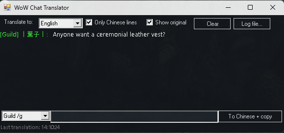

WoW Chat Translator (Emberveil)
===============================

Translates Chinese (also Japanese and Korean) chat lines from the game into
English (or Hungarian) in a small always-on-top window next to the game.
You can also reply: type in your own language and get the Chinese text on
the clipboard, ready to paste into the game chat.

Requirements
------------
- Windows (uses the built-in PowerShell, nothing to install)
- Internet connection (for the translation)

Setup
-----
1. In the game, turn on chat logging by typing:  /chatlog
   The chat confirms: "Chat being logged to Logs\WoWChatLog.txt".
   This has to be done once per login.
2. Unzip this folder anywhere and double-click ChatTranslator.bat.
   If Windows asks whether to run it: "More info" -> "Run anyway".
3. The program looks for the log file at the default Emberveil location:
     %LOCALAPPDATA%\Programs\Azeroth Launcher\Azeroth\Binaries\Win64\
     Games\Emberveil\live\Azeroth\Logs\WoWChatLog.txt
   If your game is installed elsewhere, click "Log file..." and pick your
   WoWChatLog.txt once; it is remembered.

Reading chat
------------
Every new Chinese chat line appears translated:
  green  = channel and player name
  white  = translation
  grey   = original text

Top bar:
  Translate to       - English, Hungarian or Chinese (see below)
  Only Chinese lines - otherwise all chat lines are listed
  Show original      - also show the original text under the translation
  Clear              - clear the window
  Log file...        - choose the WoWChatLog.txt file
  Magyar             - switch the program itself to Hungarian
                       (the same button says "English" to switch back)

Replying in Chinese
-------------------
1. At the bottom, choose the channel: Guild, Say, Party, Raid, World /1
   or Whisper (type the player name in the extra field).
2. Type your message in any language and press Enter
   (or click "To Chinese + copy").
3. The Chinese translation is put on the clipboard together with the
   channel command, e.g.  /g 你好
4. In the game: Enter, Ctrl+V, Enter.

Notes
-----
- Chat lines are sent to Google Translate's public web service for
  translation; nothing is sent anywhere else.
- Only lines written after the program starts are translated.
- The program never touches the game: it only reads the chat log file,
  and replies are only copied to the clipboard - you send them yourself.
- Machine translation into Chinese is understandable but not always
  natural; short, simple sentences work best.
- Window position, size and settings are saved in
  %APPDATA%\WowChatTranslator.json

Chinese mode (English -> Chinese)
---------------------------------
Choose "Chinese" in "Translate to". Then it works the other way round:
- English (any non-Chinese) chat lines are shown translated to Chinese
  ("Only non-Chinese lines" hides the Chinese ones),
- the reply line translates what you type to English ("To English + copy").
Handy for a Chinese-speaking friend playing next to you.
